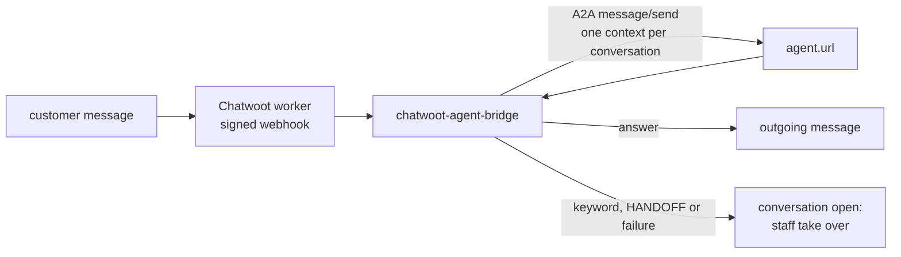
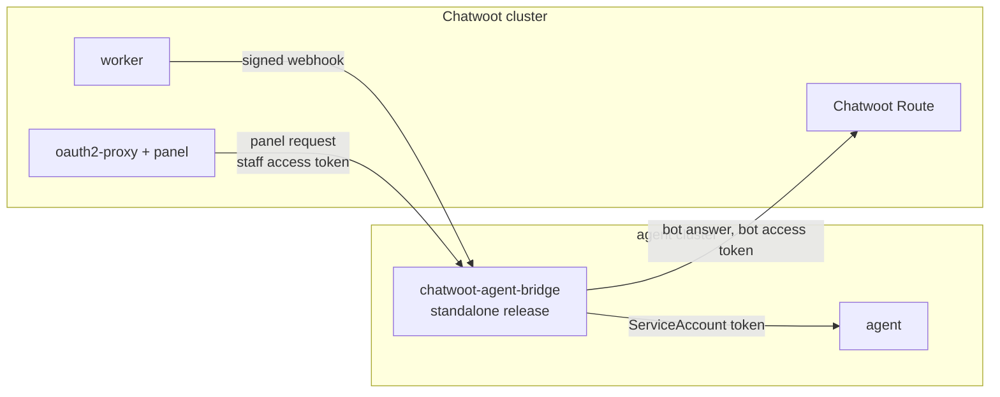
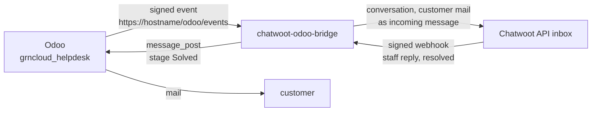

# Chatwoot

## Purpose

Chatwoot Community Edition: one screen for customer conversations, with the live chat
widget for a website and API channel inboxes that other systems fill, such as the Odoo
bridge for helpdesk tickets and CRM leads. The chart runs the
upstream Community Edition image (no enterprise code) with a PostgreSQL database with
pgvector from the CloudNativePG operator, a Valkey store on a volume, and attachments on a
volume or in an object bucket. With single sign-on, staff log in at an OIDC provider and
never use a Chatwoot password.

## Install

    helm repo add grncloud https://apps.openshift.eu
    helm install chatwoot grncloud/chatwoot

Install one release per project. The first start takes a few minutes: the database is
created, a Job migrates it and creates the account and its super admin, and web and
worker start only after that Job closed the onboarding page. There is no signup and no
onboarding page. `helm install --wait` works; give it `--timeout 15m` for the first start.

    oc get route chatwoot -o jsonpath='https://{.spec.host}{"\n"}'
    oc get secret chatwoot-credentials -o jsonpath='{.data.super-admin-password}' | base64 -d

The super admin is the break-glass account `superadmin@chatwoot.invalid` (value
`account.adminEmail`, always under the reserved domain `.invalid`), with the password
above. Without single sign-on it logs in at `/app/login` and invites the staff. With
single sign-on it logs in at `/super_admin` only: no login at the OIDC provider can become
a super admin.

| Value | Default | Meaning |
|---|---|---|
| `route.hostname` | empty | Hostname. Empty: OpenShift assigns one and the pods read it from the Route. |
| `account.name` | `Support` | Name of the account the first install creates. |
| `account.adminEmail` | empty | Break-glass super admin, an address under `.invalid`. Empty: `superadmin@chatwoot.invalid`. |
| `attachments.storage` | `volume` | `volume`: a ReadWriteOnce volume, web and worker on one node, one web pod. `objectBucketClaim`: a bucket, any number of web pods. |
| `attachments.objectBucketClaim.storageClassName` | empty | Storage class of the bucket claim; required with `objectBucketClaim`. |
| `database.instances` | `1` | PostgreSQL instances. `2` adds a standby. |
| `database.imageName` | CloudNativePG `17.11-standard-trixie` | PostgreSQL image; it must carry pgvector. |
| `web.replicas`, `worker.replicas` | `1` | Pods of the web server and of the background worker. |
| `sso.enabled` | `false` | Staff log in at an OIDC provider through oauth2-proxy and the login bridge. |
| `sso.issuerUrl` | empty | OIDC issuer; required with `sso.enabled`. |
| `sso.clientId` | empty | OIDC client. Empty: the Route host. |
| `sso.allowedGroups` | empty | Groups (claim `sso.groupsClaim`) that may log in. Empty: every user of the issuer. |
| `sso.deniedEmails` | empty | Addresses that never get a Chatwoot login, such as shared accounts of the issuer. Exact address, any case. It refuses new logins only: delete an existing Chatwoot user of the address first. |
| `sso.adminGroups` | empty | Groups whose members are account administrators, others agents. Empty: new users are agents and roles set in Chatwoot stay. |
| `sso.session.refresh` | `5m` | oauth2-proxy checks the user's groups at the OIDC provider again this often. |
| `sso.session.expire` | `12h` | An oauth2-proxy session ends after this. |
| `sso.session.chatwootHours` | `36` | A Chatwoot dashboard session ends after this many hours; 25 to 720. The dashboard keeps its session cookie for whole days rounded down, so a shorter value would end every session at once; the chart refuses it. |
| `sso.public.widget` | `true` | The live chat widget is reachable without a login. |
| `sso.public.inboxApi`, `.surveys`, `.helpCenter` | `false` | Further paths without a login. |
| `networkPolicy.webIngressFrom` | empty | Further peers that may reach Chatwoot web on port 3000. |
| `secrets.type` | `kubernetes` | `externalSecret` reads the secrets from a secret store. |
| `extraEnv` | empty | Further Chatwoot settings, for example the `SMTP_*` variables. |
| `agent.url` | empty | JSON-RPC address of the A2A agent of the bot, the panel and the drafts; required with any of them. |
| `agent.auth.type` | `none` | `serviceAccountToken`: a token of ServiceAccount `chatwoot-agent-bridge` for `agent.auth.audience`. `clientAssertion`: that token as client assertion at `agent.auth.tokenUrl` for `agent.auth.clientId`. `clientSecret`: the client secret `secrets.agentClientSecret` at `agent.auth.tokenUrl` for `agent.auth.clientId`. |
| `agentBot.enabled` | `false` | An Agent Bot answers customers through the agent until a person takes over. |
| `agentBot.inboxes` | empty | Inbox names the bot answers in; `*` is every inbox. |
| `agentBot.handoff.keywords` | `human`, `person`, `agent`, `staff` | A customer message that is exactly one of these hands the conversation to a person. |
| `copilotPanel.enabled` | `false` | A panel in the conversation sidebar where staff ask the agent; needs `sso.enabled`. |
| `draftAgent.enabled` | `false` | The agent drafts a reply to each customer message as a private note for staff. |
| `draftAgent.inboxes` | empty | Inbox names whose customer messages get a draft; `*` is every inbox. Required with `draftAgent.enabled`. |
| `agentBridge.remoteUrl` | empty | https address of a standalone bridge elsewhere. Empty: the bridge runs in this release. |
| `odoo.enabled` | `false` | Odoo tickets and leads become conversations; staff replies go back to Odoo as mail. Needs `route.hostname`, `odoo.url` and `secrets.odooApiKey`. |
| `odoo.url`, `odoo.database` | empty | https address of Odoo, and its database (empty: the server's only database). |
| `odoo.ticketInbox`, `odoo.leadInbox` | `Support`, `Sales` | API inboxes of tickets and of leads. An empty `leadInbox` mirrors no leads. |
| `odoo.solvedStage` | `Solved` | Stage a ticket moves to when its conversation is resolved. |
| `monitoring.enabled` | `false` | A ServiceMonitor of the Odoo bridge; `monitoring.namespaceLabels` names the namespaces that may scrape it. |
| `monitoring.alerts` | `true` | Alert rules of the Odoo bridge next to the ServiceMonitor; false where the platform alerts centrally. |
| `agentBridge.standalone.enabled` | `false` | A release of the bridge alone, next to the agent; needs `standalone.chatwootUrl`, and for the panel `standalone.staff.issuerUrl` and `standalone.staff.clientIds`. |

### Single sign-on

With `sso.enabled` the Route points at oauth2-proxy. Every path needs a login at the OIDC
provider, except the ones the widget needs: `/packs/js/sdk.js`, `/widget`, `/vite/assets/`,
`/api/v1/widget/`, `/cable`, the sounds under `/audio/` and images under `/assets/images/`,
and reading attachments under
`/rails/active_storage/`. The dashboard's login page goes to the login bridge in the
oauth2-proxy pod, which listens on 127.0.0.1 only. It finds or creates the Chatwoot user
of the logged-in email through the Platform API, puts it in the account, and sends the
browser to that user's one-time login link (valid five minutes, usable once). Users get a
random Chatwoot password that nobody learns. The Platform App and its token are made by
the Job; the token is in Secret `chatwoot-platform`, which only the bridge and the Job
mount.

The OIDC client needs the redirect URI `https://<hostname>/oauth2/callback` and a secret
equal to key `client-secret` of Secret `chatwoot-oauth`. Its client id is the hostname
unless `sso.clientId` is set. The bridge never logs in an address under `.invalid` or a
super admin: Chatwoot's Platform API refuses those in this chart.

### When a user leaves the allowed group

| Access | Ends |
|---|---|
| Dashboard and API through the Route | at the next session refresh, within `sso.session.refresh` |
| A Chatwoot session token used from inside the cluster, past oauth2-proxy | when it expires, within `sso.session.chatwootHours` |
| Live updates over `/cable`, which is public for the widget | only when the user is removed from the account |
| Membership of the account | only by hand |

The bridge sees logins only, so it cannot notice that a user left a group. Delete the
user when they leave: Settings, Agents, delete. That removes them from the account and,
when they are in no other account, deletes the user with all its sessions. Then restart
the web pods (`oc rollout restart deployment/chatwoot-web`), which ends their open live
update connection.

### Network

The chart's NetworkPolicies admit the paths between its own components, but they add to
the platform's policies and cannot narrow them. A platform policy that admits every pod of
the same tenant, or of the same project, still reaches Chatwoot web on port 3000, the store
on port 6379 and oauth2-proxy on port 4180 directly. Such a pod meets Chatwoot's own
password logins (`/auth/sign_in`, `/super_admin`), never the single sign-on; every password
is random and unknown. The login bridge has no network port at all, so no pod can send it
an identity header.

### Mail

Chatwoot sends no mail unless `extraEnv` sets `SMTP_ADDRESS` and the other `SMTP_*`
variables. Without them password reset and notification mails are switched off.

### Agent Bot

With `agentBot.enabled` an A2A agent answers customers. The prepare Job creates the Agent
Bot `agentBot.name` on every install and upgrade, with the access token and webhook secret
of Secret `chatwoot-agent-bot` (only the Job and the bridge mount it), and connects it to
exactly the inboxes of `agentBot.inboxes`; an inbox created later is connected on the next
upgrade. A conversation in such an inbox starts as pending, held by the bot:

- The bridge refuses a webhook without a valid `X-Chatwoot-Signature`, and only the worker
  pods reach it.
- The first message of a conversation carries `agentBot.instructions`; the A2A context id is
  kept in the conversation's custom attribute `a2a_context_id`, so later messages continue it.
- Chatwoot refuses webhooks to private addresses. The chart initializer of web and worker
  allows a private address for the bridge Service alone.
- Once a conversation is open the bot stays silent in it, until staff set it back to
  pending.

### Agent panel

With `copilotPanel.enabled` the Job registers a Dashboard App `copilotPanel.title` at
`https://<hostname>/agent-panel/`: a tab next to every conversation. Staff choose
**Summarise**, **Suggest reply** or ask a free question; the agent gets the conversation's
messages, private notes marked as such, and the staff member's address. A suggested reply
goes into the reply box (or the clipboard) for staff to edit and send; nothing the panel
returns is sent to the customer. The panel runs in the oauth2-proxy pod on 127.0.0.1, so
it is reachable only after the staff login.

### AI drafts

With `draftAgent.enabled` the agent drafts the next reply to every customer message in
`draftAgent.inboxes`, and the bridge adds the draft to the conversation as a private note
headed `draftAgent.heading`. Staff read it, edit it and send it themselves; the conversation
stays with staff and no draft reaches the customer.

- The prepare Job keeps a Chatwoot agent `draftAgent.name` (`draftAgent.email`, under
  `.invalid`) with the access token of Secret `chatwoot-draft`, member of the listed inboxes
  only, and an account webhook of `message_created` to the bridge, signed with the draft
  webhook secret of that Secret.
- The bridge checks the signature, reads the conversation's messages as that agent, leaves
  earlier drafts out, and asks the agent with `draftAgent.instructions` and the transcript
  (private notes of staff included, marked as such). Every write of the draft path goes
  through one function that refuses any message that is not private.
- A customer who writes again before a draft is done gets one draft, for the newest
  message. When the agent fails or returns nothing, no note is written.
- The bridge runs in this release: `draftAgent.enabled` excludes `agentBridge.remoteUrl`
  and `agentBridge.standalone.enabled`.

### Bridge next to the agent

When the agent trusts identities of its own cluster only, the bridge runs there, in a
release of this chart with `agentBridge.standalone.enabled` (no Chatwoot, only the bridge
and a Route), and the Chatwoot release names that Route in `agentBridge.remoteUrl`:

| Path | Checked by |
|---|---|
| Webhook, Chatwoot to bridge | the webhook secret (`X-Chatwoot-Signature`), the same vault item in both releases |
| Panel request, Chatwoot to bridge | the staff member's own access token, passed by oauth2-proxy: signature, issuer, client (`staff.clientIds`, the `azp` claim) and group (`staff.allowedGroups`) |
| Bridge to agent | `agent.auth` of the standalone release |
| Bridge to Chatwoot | the bot's access token; the Chatwoot release lets `POST` to a conversation's `messages`, `toggle_status` and `custom_attributes` pass oauth2-proxy without a login, and Chatwoot checks the token |

Those three `POST` paths then accept any Chatwoot access token without the staff login, a
user's as well as the bot's. The bot's access token and webhook secret are in both
releases (`secrets.externalSecret.items` naming the same vault items).

### Odoo bridge

With `odoo.enabled`, Odoo stays the owner of tickets, leads and mail; Chatwoot is the screen
staff answer in. Deployment `chatwoot-odoo-bridge` carries both directions:

- Odoo signs each event (`X-Grncloud-Signature`, HMAC-SHA256 over timestamp and body, 300
  seconds tolerance) with `secrets.odooEventSecret`. The event names a record id only; the
  bridge reads the record through the Odoo JSON-2 API with `secrets.odooApiKey`.
- A ticket or lead gets one conversation, with custom attributes `odoo_ref` and `odoo_url`;
  Odoo keeps the conversation address in `x_chatwoot_url`. A customer mail appears once, as
  an incoming message with source id `odoo:mail.message:<id>`, without Odoo's quoted history.
- A public reply of a staff member is posted on the record as a comment from the matching
  Odoo user, and Odoo mails it to the customer: the record's partner, or for a record
  without one (most mailed-in leads) the partner of its address, which Odoo finds or
  creates. A record without any address gets no mail, and a private note says so. Private
  notes, bot messages and messages in other inboxes are never sent. A reply with
  attachments is sent without them, and a private note says so.
- The bridge acts only on a record whose `x_chatwoot_url` names the conversation, so an
  edited `odoo_ref` cannot send a reply to another customer or solve another ticket.
- Resolving a conversation moves the ticket to `odoo.solvedStage`; a closed ticket resolves
  its conversation.
- An Odoo event is answered within 2.5 seconds, or 503 while it is still busy, and Odoo
  retries it from its outbox (8 attempts, up to 2 hours apart). A record deleted in Odoo
  ends the retries.
- Chatwoot never retries a webhook and marks the message failed on any answer but 200. The
  bridge therefore answers a valid webhook at once and retries it itself, after 5 seconds,
  30 seconds, 2, 10 and 30 minutes. When the last attempt fails, or the pod stops before a
  reply is delivered, the reply is not sent: a private note asks staff to send it again.
  `chatwoot_odoo_bridge_webhooks_total{result="given_up"}` counts the replies given up; one
  lost at a stop is in the log. The queue lives in the pod, so the bridge runs one pod and
  replaces it with `Recreate`.
- The Job creates user `Odoo` (`odoo-bridge@chatwoot.invalid`), the two API inboxes with the
  bridge as webhook, and the custom attributes. Staff choose who works in an inbox in
  Chatwoot.
- The chart's NetworkPolicy admits the worker pods to the webhook port and the router to
  the event port (Route path `/odoo/events`); a platform policy may open more, so both check
  the signature of every request. `/metrics` on port 8080 counts events, webhooks,
  failures and retries waiting; with `monitoring.enabled` the scraping namespaces may reach
  it, and `monitoring.alerts` adds ChatwootOdooBridgeDown, ChatwootOdooBridgeReplyLost and
  ChatwootOdooBridgeEventsFailing.

### Agent credentials

| `agent.auth.type` | The agent receives |
|---|---|
| `none` | no credential: an agent inside the project, or one behind its own network rules |
| `serviceAccountToken` | a token of ServiceAccount `chatwoot-agent-bridge` for `agent.auth.audience`, renewed by the kubelet |
| `clientAssertion` | an access token of `agent.auth.tokenUrl`, for which that ServiceAccount token is the client assertion (RFC 7523) of client `agent.auth.clientId` |
| `clientSecret` | an access token of `agent.auth.tokenUrl` for client `agent.auth.clientId`, granted with the client secret of Secret `chatwoot-agent-client` (`secrets.agentClientSecret`, or vault item `secrets.externalSecret.items.agent-client-secret`) |

Only `clientSecret` stores a credential of the agent in the project. Use it when the OAuth
server cannot tell this cluster's ServiceAccount tokens from those of another cluster with
the same issuer.

### Interfaces for integrations

Service `chatwoot-web` port 3000 serves the Chatwoot API (`/api/v1/accounts/...` with a
user or bot access token) inside the project. A component in another project needs
`networkPolicy.webIngressFrom`.

`helm uninstall` deletes the database and the store, and keeps the attachment volume or
bucket.

## How to login

- **Single sign-on**: with `sso.enabled`, staff open `https://<hostname>/` and log in at
  the OIDC provider `sso.issuerUrl`. A member of `sso.allowedGroups` becomes a Chatwoot
  user of the account on the first login; a member of `sso.adminGroups` becomes an
  administrator, everyone else an agent. With `sso.adminGroups` empty, new users are agents
  and roles set in Chatwoot stay. The managed version (Template `chatwoot-managed`)
  switches it on.
- **Admin user**: the break-glass super admin `superadmin@chatwoot.invalid` (value
  `account.adminEmail`), password in Secret `chatwoot-credentials`, key
  `super-admin-password`. It logs in at `/super_admin` with single sign-on, and at
  `/app/login` without it:

    oc -n <project> extract secret/chatwoot-credentials --keys=super-admin-password --to=-

## Delivery instructions

- The chart needs the CloudNativePG operator on the cluster, version 1.26 or later. The
  platform team installs it and can add scheduled database backups to object storage.
- A hostname outside the default application domain needs a DNS record pointing at the
  platform's ingress. Ask the platform team for the target; the certificate follows
  automatically once the name resolves.
- `attachments.storage: objectBucketClaim` needs an object bucket storage class from the
  platform team. Chatwoot serves the files itself, so the bucket needs no public address.
- For single sign-on, ask the platform team for the OIDC issuer and a client as described
  above, or register one at your own provider.
- For the Agent Bot or the panel, give `agent.url` the A2A address of the agent and agree
  with its owner how it authenticates the bridge (`agent.auth`).
- For the Odoo bridge, Odoo needs the module `grncloud_helpdesk` and an internal user for
  the bridge with an API key (`secrets.odooApiKey`). It reads and writes helpdesk tickets
  and CRM leads, posts messages on them, reads `mail.message`, `res.users` and
  `helpdesk.stage`, and creates contacts (`res.partner`) for a lead without one. Set system
  parameter `grncloud_helpdesk.bridge_url` to `https://<hostname>/odoo/events` and give
  Odoo the event secret in
  `GRNCLOUD_HELPDESK_BRIDGE_SECRET_FILE` (the value of `secrets.odooEventSecret`; leave that
  empty and read it from Secret `chatwoot-odoo` after the install). Staff log in to Chatwoot
  with the same address as their Odoo user, or replies are posted as the bridge user.
- With `secrets.type=externalSecret`, create the items named in
  `secrets.externalSecret.items` in your vault collection with the value in the password
  field, and set `secrets.externalSecret.storeName` to your store. The super admin
  password needs an upper and a lower case letter, a digit and a sign.

## Why not the official Chatwoot Helm chart?

The [official chart](https://github.com/chatwoot/charts) (`chatwoot` 2.0.27, Chatwoot
v4.18.0) runs the standard Chatwoot web server and Sidekiq worker. An external database
and Redis, the image tag, resources of web and worker, and an extra environment Secret are
values there, and the database, the store, the bucket, the Route, single sign-on and the
NetworkPolicies could be added next to it. What this chart needs beyond that requires
changes to the official chart's templates:

- **Container security context**: its `securityContext` value is set on the pod only, so
  the containers cannot drop all capabilities and forbid privilege escalation as the
  `restricted-v2` security context constraints expect of a chart here.
- **Volumes and mounts**: web and worker take no extra volumes. This chart mounts a Rails
  initializer (attachments streamed by Chatwoot from an in-cluster bucket, the dashboard
  session length, no super admin through the Platform API) and the database CA for
  verified TLS.
- **Environment from other objects**: apart from the database and Redis passwords,
  settings come from values or one Secret as a whole. The bucket's host and name are in
  the ObjectBucketClaim's ConfigMap and its keys in its Secret, which this chart reads
  variable by variable.
- **Order of a deployment by Argo CD**: migrations run as a Helm hook, which Argo CD runs
  before every other object or after all of them. This chart migrates in a sync wave
  between the database and the web and worker.
- **Initialization**: no value adds an init container or a start command. This chart
  sets up the account, its super admin and the login bridge's Platform App before
  web serves, so the page that makes the first visitor super admin never opens, and web
  and worker wait until no migration is pending.

This chart covers these points and has been tested on OpenShift, single sign-on included.
The official chart becomes the base again once its templates offer these extension points;
open pull requests there add container and pod security contexts
([#196](https://github.com/chatwoot/charts/pull/196),
[#150](https://github.com/chatwoot/charts/pull/150)) and extra volumes for web and worker
([#197](https://github.com/chatwoot/charts/pull/197)).
