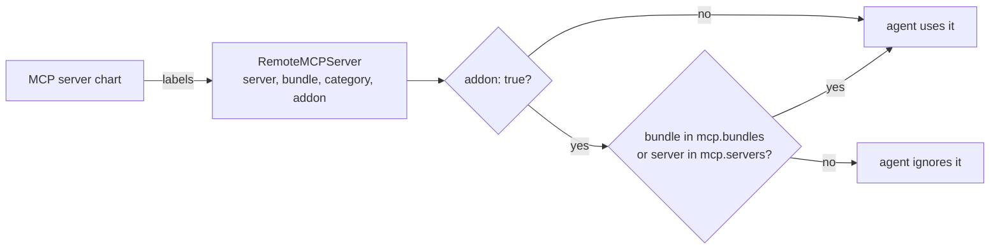

# MCP catalog labels

An MCP server chart labels its kagent `RemoteMCPServer` with the server's name, bundle and
category. An agent uses every server it can see, except an add-on: an add-on server reaches
an agent only when the agent asks for its bundle or its name. The same keys in `Chart.yaml`
feed the [MCP catalog](../mcp-catalog.md) and the search of the chart website.



## Labels on the RemoteMCPServer

| Label | Value | Effect |
|---|---|---|
| `mcp.openshift.eu/server` | Name of the server, for example `gmail` | The name an agent lists in `mcp.servers`. Without the label the agent matches the object name |
| `mcp.openshift.eu/bundle` | Name of the bundle, for example `google-workspace` | The name an agent lists in `mcp.bundles` to get every server of the bundle |
| `mcp.openshift.eu/category` | Category, for example `productivity` or `code-quality` | Grouping in the catalog; no effect on an agent |
| `mcp.openshift.eu/addon` | `"true"` | Makes the server an add-on: used only by an agent that selects its bundle or its name. Without the label every agent that can see the server uses it |

A chart that runs the server itself, rather than pointing at a hosted one, puts the same
`server`, `bundle` and `category` labels on its Service and Deployment too.

The prefix `mcp.openshift.eu` is a value of every server chart, `mcp.labelDomain`. Change it
only together with the same value of every agent chart in the project: an agent reads the
labels under its own `mcp.labelDomain` and ignores others.

## Annotations

| Annotation | On | Value | Effect |
|---|---|---|---|
| `openhands.dev/icon` | RemoteMCPServer | URL of an image | The icon of the server's card in OpenHands. Without it, the logo of a known server name, else a default icon |
| `openhands.dev/auth` and the other `openhands.dev/oauth-*` keys | RemoteMCPServer | | Every user logs in to the server with OAuth: see [Agent OAuth login](oauth.md) |

## Keys in Chart.yaml

`Chart.yaml` of a server or bundle chart repeats the catalog keys, so the catalog is built
without installing anything.

| Key | Kind | Value |
|---|---|---|
| `mcp.openshift.eu/server` | annotation | As the label. A chart with this annotation is an MCP server chart: its release also carries a `server.json` in the MCP Registry format |
| `mcp.openshift.eu/bundle` | annotation | As the label; on a bundle chart, the bundle it installs |
| `mcp.openshift.eu/category` | annotation | As the label |
| `mcp.openshift.eu/auth` | annotation | `oauth2` when every user logs in to the server with OAuth |
| `mcp` | keyword | Every MCP chart |
| `mcp-server` or `mcp-bundle` | keyword | A single server, or a bundle of servers |
| bundle name, category | keyword | The values of the annotations above, for search |

Chart names follow the same split: `mcp-<server>` for one server, `mcp-bundle-<bundle>` for a
bundle that depends on its server charts with a switch `<alias>.enabled` each, and `mcp-all`
for every bundle.

## Selecting add-ons in an agent

The `openhands` chart turns every RemoteMCPServer its ServiceAccount may list into an MCP
server of the agent and keeps that list in step. These values of the chart, from version
0.10.0, decide which add-ons it takes.

| Value | Default | Effect |
|---|---|---|
| `mcp.enabled` | `true` | Discover RemoteMCPServers at all |
| `mcp.labelDomain` | `mcp.openshift.eu` | Prefix of the labels `<labelDomain>/addon`, `/bundle` and `/server` that the agent reads |
| `mcp.bundles` | `[]` | Add-on bundles to use, for example `[google-workspace]` |
| `mcp.servers` | `[]` | Add-on servers to use by name, for example `[gmail]` |
| `mcp.labelSelector` | `""` | Only RemoteMCPServers that match this label selector, for example `team=sales`; applies to add-ons and other servers alike |
| `mcp.interval` | `60` | Seconds between two passes |

```yaml
# an agent that uses Gmail and the whole Microsoft 365 bundle, next to every
# server of the project that is not an add-on
mcp:
  bundles:
  - microsoft-365
  servers:
  - gmail
```

- Removing a bundle or server from the list removes the server from the agent on the next
  pass; deleting the RemoteMCPServer does the same.
- The user's on and off switch of a server in the agent's settings is kept on every pass.
- A server added by hand in the agent's settings is left alone.
- The former name of these values, `mcpDiscovery`, is still read and its keys override
  `mcp`; it is deprecated and goes away in a major version.
